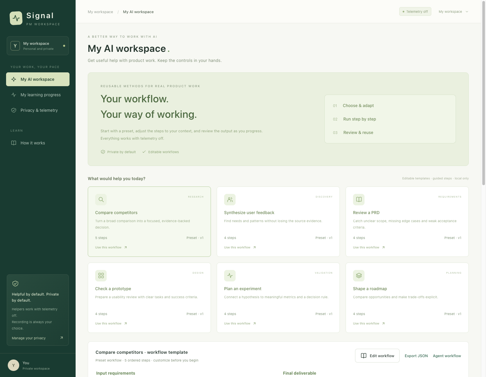
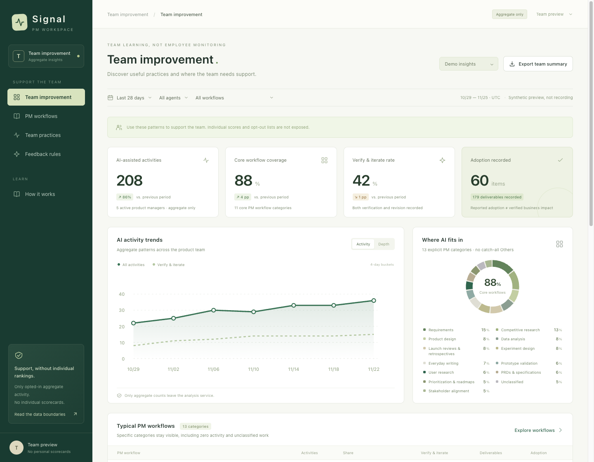

# PM Signal

**Useful AI workflows for product managers. Private feedback. Recording by choice.**

PM Signal is a small reference prototype for discussing AI adoption in product teams. It starts with practical workflows for PMs and gives leads aggregate insights about where AI fits into the work. Telemetry is optional and off by default. The prototype illustrates a product direction rather than establishing productivity or business impact.

## Background and goals

Product leads want AI to help with research, requirements, design and decisions. Seat counts and prompt counts do not show that improvement, while mandatory monitoring can encourage resistance or performative usage. The hypothesis here is to give PMs useful workflows first, keep personal feedback private and let them choose whether recorded metadata contributes to team statistics.

The intended flow is to configure an agent integration once, then open the local workspace. No second connection step or self-reported method-sharing task appears in the dashboard. [Product and experience](docs/product.md) explains these choices, the workflow process and privacy controls together.

## Interface preview

Saved screenshots show the current English interface at 1440 × 1120. Team figures are **synthetic demo data**, not measured adoption or a live Elasticsearch result. Additional workflow steps and statistics appear below these viewport previews.

### PM workspace

Choose from six editable workflows, adapt their steps and review results as you progress. Telemetry starts off; local workflow execution remains available.



### Team view

Inspect workflow coverage, activity trends and collaboration behaviors. The team sees no individual scores, task briefs or work-session content.



## Start and try it

Requires **Node.js 22+**. There is no third-party runtime dependency or build step.

```sh
npm run dev
```

Open **http://127.0.0.1:4310/** for the PM workspace or **http://127.0.0.1:4310/team** for the team preview.

1. Choose a workflow and use **Edit workflow** to adapt its inputs, steps and review checks.
2. Start a run, copy each step to your agent, paste the result back and review before advancing.
3. Confirm a local run save only if you want to retain the brief, results and progress. Otherwise they stay in browser memory.
4. Inspect **Privacy & telemetry**; both recording and team contribution start off.
5. Explore **Demo insights** in the team view. **Shared aggregates** reads stored data under contribution consent and a minimum cohort guard.

The prototype prepares prompts locally; it does not automatically call an agent. Native plugin packaging is manual. The service represents one local identity, and the view selector previews experiences rather than implementing hosted multi-user roles.

## Implemented capabilities

| Area | Current behavior |
| --- | --- |
| PM workflows | Six editable templates, ordered review gates, version snapshots and local import/export |
| Local saves | Explicit category/date practice records and separately confirmed full run snapshots |
| Personal feedback | Private statistics and an optional configurable point index |
| Telemetry | Default off, hook consent preflight and server-side ingestion gate |
| Team view | 13 workflow categories and seven behaviors, voluntary contribution and small-cohort suppression |
| Capture and storage | Native payload normalization, configurable keyword recognition, replay CLI, JSONL / Elasticsearch adapters |

The dashboard reads the PM Signal API; only the server connects to ES. ES holds derived event metadata, while consent/rules remain local JSON and browser workflow content remains local. [Integrations](docs/integrations.md#elasticsearch-and-the-team-dashboard) covers configuration, ingestion, collected-mode selection and the single-identity cohort limitation. Switching storage drivers does not migrate data.

## Documentation

Detailed documentation lives in [docs/](docs/README.md), organized by the questions a reader needs answered:

| Guide | Contents |
| --- | --- |
| [Product and experience](docs/product.md) | Background, design rationale, both views, editable workflows, privacy choices and prototype scope |
| [Architecture](docs/architecture.md) | Modules, data flow, contracts, consent enforcement, recognition and private scoring |
| [Integrations](docs/integrations.md) | Agent hooks, collector/replay, runtime configuration, ES storage and team dashboard reads |

## Verify

```sh
npm test
npm run verify:browser
```

Tests cover recognition/scoring, persistence, consent, access scope, deletion, capture/replay and ES operations. Browser verification uses local Chrome, isolated runtime data and screenshots in the ignored `artifacts/` directory. The saved README images are in `docs/screenshots/`.

Native installation has not been live-validated in every client. ES behavior is tested with simulated responses, not a live cluster. Automatic agent execution, multi-user identity, cross-device sync and validated adoption outcomes remain outside this reference prototype.
