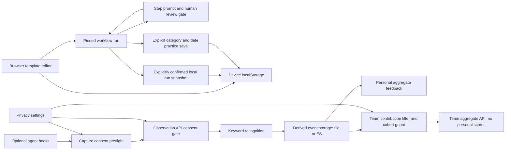

# PM Signal architecture

This guide explains the implementation behind the personal workflow workspace and team statistics. Read [Product and experience](product.md) for the rationale and controls, and [Integrations](integrations.md) for agent hooks, replay, configuration and Elasticsearch setup.

- [Runtime and modules](#runtime-and-data-flow)
- [Workflow engine](#workflow-engine)
- [Consent and identity](#consent-and-identity)
- [APIs and observation contract](#apis)
- [Recognition rules](#recognition-rules)
- [Private scoring policy](#private-scoring-policy)
- [Statistical scopes and storage](#statistical-scopes)

## Runtime and data flow

One Node.js process serves vanilla JavaScript/CSS/SVG pages and HTTP APIs. There is no build step, third-party runtime dependency or model call in the browser helpers.



Briefs, step results and checks stay in browser memory by default. Explicit template saves retain browser-local overrides; full run snapshots require separate confirmation to persist their content locally. Practice-log saves retain only category/date metadata. Workflow actions do not generate telemetry or points, and no workflow content enters the server or ES. The user flow and storage choices are in [Product and experience](product.md#local-saves-and-deletion). Native hook input is optional, content transfer is independently opt-in, and original observation text is used transiently rather than written to the event store.

## Modules

| Module | Responsibility |
| --- | --- |
| [`public/app.js`](../public/app.js) | Personal/team navigation, workflow editor and guided runner, practice log, privacy controls and statistics |
| [`public/workflow-templates.js`](../public/workflow-templates.js) | Six preset methods with inputs, ordered instructions, deliverables and checks |
| [`public/workflow-engine.js`](../public/workflow-engine.js) | Validation, pinned versions, step prompts, review gates and downstream invalidation |
| [`public/workflow-storage.js`](../public/workflow-storage.js) | Browser-local template overrides and explicitly confirmed run snapshots |
| [`public/styles.css`](../public/styles.css) | Responsive workspace, helpers, switches and statistical views |
| [`server.mjs`](../server.mjs) | Routing, personal capability, request validation, consent gating and aggregate data scopes |
| [`lib/privacy.mjs`](../lib/privacy.mjs) | Persistent preferences, serialized consent/write gate, team contribution and owned deletion |
| [`collector/capture.mjs`](../collector/capture.mjs) | Native hook normalization, consent preflight and short delivery retries |
| [`collector/collect.mjs`](../collector/collect.mjs) | Replay/import transport for labeled events or unlabeled observations |
| [`lib/recognition.mjs`](../lib/recognition.mjs) | Literal keyword matching, ambiguity handling and derived events |
| [`lib/rules.mjs`](../lib/rules.mjs) | Validated defaults/overrides, atomic saves and revisions |
| [`lib/model.mjs`](../lib/model.mjs) | Event validation, 13 workflow categories, seven behaviors, internal grouping and sample generation |
| [`lib/analytics.mjs`](../lib/analytics.mjs) | UTC filtering, workflow/behavior counts, trends and optional private feedback |
| [`lib/scoring.mjs`](../lib/scoring.mjs) | Discounted points, activity/daily caps and private 0–100 feedback |
| [`lib/storage.mjs`](../lib/storage.mjs) | File and Elasticsearch event adapters, including exact-owner deletion |

## Workflow engine

```json
{
  "id": "my-prd-review",
  "task": "documentation",
  "title": "My PRD review",
  "description": "Review scope and testability before delivery.",
  "tag": "REQUIREMENTS",
  "icon": "book",
  "version": 1,
  "inputs": ["PRD and product decision", "Constraints and source references"],
  "output": "A prioritized revision list with unresolved questions.",
  "steps": [{
    "id": "scope",
    "title": "Check scope",
    "instructions": "Review {{brief}}. Identify unclear goals and missing non-goals.",
    "output": "Scope gaps with references and clarification questions.",
    "checks": ["Each gap links to a requirement", "Assumptions are marked"],
    "requiredOutput": true
  }]
}
```

Supported placeholders are `{{brief}}`, `{{previous_output}}` and `{{previous_outputs}}`. Substitution is literal text; templates cannot execute JavaScript or shell commands through the engine. Prompts include earlier reviewed outputs even when a template does not use placeholders.

`public/workflow-templates.js` defines the six presets. `public/workflow-engine.js` validates templates and saved runs, creates pinned runs, generates prompts and enforces review gates. `public/workflow-storage.js` manages validated local overrides and consent-required snapshots. `public/app.js` implements the editor and runner. These modules have no collector or server-write dependency.

The product behavior and local-save choices are documented in [Product and experience](product.md#editable-workflows-and-guided-execution). Automatic provider execution remains future work.

## Consent and identity

`PrivacyStore` defaults to `{telemetryEnabled:false, teamSharingEnabled:false}` for missing preferences. Turning telemetry off forces contribution off. It does not delete private past events. Personal deletion removes uploaded metadata explicitly.

Ingestion and preference updates use one serialized transaction queue. The API validates batch shape first, then checks every member's consent inside the gate before recognition or append. A batch containing a paused member returns HTTP 202 with zero accepted events and a paused-record count. It is not partially admitted.

A disable acknowledgment follows any previously admitted writes. Later writes are refused. This ordering is local to one server process, not a distributed guarantee.

`capture.mjs` checks the paired workspace's status before reading stdin or posting event content. Missing/unavailable consent stops capture. `PM_SIGNAL_TELEMETRY=off` exits before even that control request. There is no offline queue to flush unexpectedly; future queues must re-check consent before delivery.

### Personal capability

The service has one identity, from `PM_SIGNAL_MEMBER_ID` (default `pm-01`). Loopback requests to `/` receive a personal HttpOnly/SameSite cookie. `PERSONAL_TOKEN` can provide the capability; otherwise it is random per process. `/team` does not issue it.

Personal APIs require that capability and always use the configured identity. They reject attempts to select another member. This is a local owner workspace; the view selector previews experiences and is not a production multi-user role system. A hosted deployment must supply authenticated per-user sessions and scope collector credentials appropriately.

## APIs

| API | Behavior |
| --- | --- |
| `GET /api/me/preferences` | Owner settings and setup identity |
| `PUT /api/me/preferences` | Owner-only telemetry/contribution update |
| `GET /api/me/dashboard` | Owner-only aggregate metadata; optional private point feedback |
| `DELETE /api/me/data` | Disable recording and remove exact-owner event metadata |
| `GET /api/dashboard` | Opted-in team aggregates; `adoption:null`, no per-person scores |
| `GET /api/telemetry/status` | Minimal recording status for the paired workspace identity |
| `POST /api/events` | Validate labeled events, then enforce consent and append |
| `POST /api/observations` | Enforce consent, recognize unlabeled observations and append derived metadata |
| `POST /api/recognize` | Explicit rule preview without persistence |
| `GET /api/rules` | Rules/revision with the member directory omitted |
| `PUT /api/rules` | Revision-checked config save; private directory preserved server-side |
| `GET /api/config` | Non-secret storage and capability metadata |

Private routes use the personal capability. Event/observation/rule writes additionally use `INGEST_TOKEN` if configured. Browser mutation requests reject cross-site origins. JSON bodies are capped at 1 MiB; observation batches have 1–100 records and event batches 1–500.

## Observation contract

`POST /api/observations` accepts 1–100 observations and at most 1 MiB. The optional ingestion token still applies, but does not override consent: paused batches return zero accepted records and are neither recognized nor stored.

```json
{
  "observations": [{
    "id": "competitor-task-01",
    "sessionId": "competitor-analysis",
    "memberId": "pm-01",
    "source": "codex",
    "kind": "prompt_submitted",
    "timestamp": "2026-11-25T01:00:00.000Z",
    "text": "Compare competitors and their pricing. Identify alternatives.",
    "origin": "sample"
  }]
}
```

| Field | Contract |
| --- | --- |
| `id`, `sessionId`, `memberId` | Required nonempty strings, maximum 160 characters |
| `source` | `claude`, `codex` or `copilot` |
| `kind` | `prompt_submitted`, `tool_completed`, `task_completed` or `adoption_confirmed` |
| `timestamp` | Valid date; normalized to UTC; at most five minutes ahead of server time |
| `text` | Optional permitted task/result excerpt, at most 8,000 characters |
| `toolName` | Optional provider tool label, maximum 160 characters; tool names alone do not determine PM semantics |
| `contextProvided` | Optional boolean declaration of provided context |
| `artifactProduced` | Optional boolean declaration; accepted as a deliverable signal on tool/task completion |
| `origin` | `sample` for sample data; otherwise `collector` |

Text is used transiently during recognition and is not written to event storage. The derived event retains generic title/evidence, rule revision, observation ID and classification methods. There is no raw observation history endpoint.

## Recognition rules

The defaults are in [`config/default-rules.json`](../config/default-rules.json). [`lib/recognition.mjs`](../lib/recognition.mjs) lowercases and normalizes whitespace, then matches literal keywords. English word boundaries prevent short words from matching inside unrelated words; Chinese phrases use substring matching. There are no arbitrary regexes or external model calls.

Each enabled workflow rule specifies a category, keywords and `minMatches`. Rules below the threshold are ignored. The category with the largest keyword-match count wins. Equal top counts across different categories produce `unknown`; unmatched observations also produce `unknown`. There is no automatic Others bucket.

The rule result is a match outcome, not a calibrated probability. Keyword count does not validate the quality of the product work.

### Collaboration recognition

| Behavior | Signal |
| --- | --- |
| Prompt initiation | Directly observed `prompt_submitted` |
| Context | `contextProvided` declaration, or configured context keywords |
| Comparison | Configured keywords; prompt matches may represent intended rather than completed comparison |
| Verification | Completion observations only, using keywords such as `verified` / `cross-checked`; configured negative phrases exclude matches |
| Revision | Completion observations only, using past-action keywords such as `revised` / `corrected` |
| Deliverable | Explicit `artifactProduced` declaration on a completion observation |
| Adoption | Explicit `adoption_confirmed` observation; never inferred from a word such as “adopted” |

Keyword-derived actions are marked `inferred`; explicit declarations are marked `declared`; prompt submission is `observed`. Rule-derived workflow labels have `taskMethod=rules`. These are provenance categories, not guarantees of truthful reporting.

An observation without a supported action produces an internal `observe` carrier event. It preserves classification and activity count without inventing a prompt submission. It does not add a new displayed behavior or score.

Derived IDs hash provider, member, observation ID and action. Replaying the same observation under the same rules deduplicates writes. Repeated real tasks need distinct observation IDs; hashing task text alone would collapse legitimate activity.

## Private scoring policy

Points are optional private feedback. The team API never receives scoring rules and does not publish personal scores. These are configurable illustration values rather than a validated adoption measure.

Workflow points are awarded once per activity, based on its primary category:

| Workflow | Points |
| --- | ---: |
| User research | 10 |
| Requirements | 10 |
| Competitive research | 8 |
| Product design | 8 |
| Data analysis | 10 |
| Prioritization / roadmaps | 10 |
| Experiment design | 12 |
| Prototype validation | 12 |
| PRDs / specifications | 6 |
| Stakeholder alignment | 5 |
| Launch reviews / retrospectives | 10 |
| Everyday writing | 1 |
| Unclassified | 0 |

Collaboration points are awarded once per distinct behavior per activity:

| Behavior | Points |
| --- | ---: |
| Provide context | 2 |
| Initiate task | 0 |
| Compare alternatives | 3 |
| Verify findings | 5 |
| Revise output | 4 |
| Record deliverable | 3 |
| Record adoption | 5 |

These values are editable policy defaults. Unclassified workflow points must stay zero. Action points are independent: an unclassified workflow can still have recognized collaboration behaviors. Writing points can be changed; its default does not prove that every email has low value.

### Score calculation

[`lib/scoring.mjs`](../lib/scoring.mjs) calculates each PM's score for the selected date/platform/workflow filters.

```text
eligible activity points = workflow points × workflow multiplier
                         + sum(distinct behavior points × behavior multiplier)

activity credit = min(eligible activity points, per-activity cap)
daily credit    = min(sum(activity credit for the PM on that UTC day), daily cap)
period points   = sum(daily credit)
period target   = weekly target × selected days / 7
adoption index  = min(100, round(period points / period target × 100))
```

Defaults: **30 points per activity**, **60 points per PM per UTC day**, **250 target points per seven days**, and **0.5 multiplier for inferred signals**. Rule-inferred workflow points are discounted too. Manual labels, observed actions and explicit declarations use full weight. If the same behavior has multiple records, the strongest method determines its one-time credit; repetition does not create extra points.

Caps apply across agent platforms. Workflow/behavior contributions are reduced proportionally when a cap applies so the breakdown explains credited points. Display values round to two decimals; component rounding can produce small display differences.

For example, “Compare competitor pricing” produces a rule-classified competition workflow and inferred comparison: `8 × 0.5 + 3 × 0.5 = 5.5` eligible points. An explicit artifact signal would add 3 points. Repeating the comparison event inside that activity does not add another 1.5 points.

Scores of 0–24, 25–49, 50–74 and 75–100 receive provisional activity-policy labels: Exploring, Developing, Consistent and Established. A roster member with no captured activity is Not observed. Labels do not establish skill quality or an empirically calibrated adoption maturity level.

The personal response contains only the owner's feedback. The optional UI compares that owner's prior period under the same current policy. The public team response never receives scoring rules and returns no personal index, labels or contribution breakdowns. Team improvement metrics remain workflow/behavior aggregates.


## Statistical scopes

Events are internally grouped by member/provider/session; activity time is the last event time. Date windows use UTC natural days and support 7, 14 and 28 days. Behavior incidence counts activities with an action, while event counts include repetitions. These rates overlap rather than sum to 100%.

The personal read path filters to the configured owner before scoring. It returns only one owner row labeled You. Point feedback is optional/collapsed in the UI and is compared to that owner's prior period under the same current rules.

The team read path filters to members with both recording and contribution enabled, then applies source/workflow/date filters. A collected cohort smaller than `TEAM_MIN_PARTICIPANTS` (default 3) is withheld. The UI does not substitute an individual's opt-out with a low score. This is a basic cohort guard, not complete anonymity protection.

The public path never invokes per-member scoring. Reports follow the corresponding scope: private summary for the owner, aggregate summary for the team. Both exclude session content. No method-sharing publication path is included.

Synthetic demo statistics are labeled, do not imply current recording and never enter event storage.

## Storage

`FileStorage` serializes append/delete operations, deduplicates IDs and reads JSONL. Exact-owner deletion rewrites the file atomically. It remains a single-process prototype without compaction, crash repair or cross-process locking.

`ElasticsearchStorage` uses built-in HTTP fetch, strict field mappings, Bulk `create` with event IDs, 409 duplicate handling and Scroll pagination. Recognition metadata mappings can be added to an existing index. Exact-owner deletion uses `_delete_by_query` with a `memberId` term and checks failure results.

Both drivers return events to the server for analysis; ES does not perform recognition or score computation. [Integrations](integrations.md#elasticsearch-and-the-team-dashboard) documents server configuration, consent, collected-mode selection, ES requests and the single-workspace cohort limitation. Raw event records are never returned to the browser. Real-cluster integration remains unverified.

Preferences and rule overrides are local JSON files, even with ES event storage. Multi-instance deployment needs a shared transactional consent store, authenticated identity and correct deletion/reclassification semantics.

## Rule configuration

Defaults are source-controlled. Saved runtime overrides go to `RULES_FILE`, or `DATA_DIR/rules.json` by default. [`lib/rules.mjs`](../lib/rules.mjs) validates allowed categories, keywords, values and methods, writes atomically, and computes a revision from the complete validated configuration.

Rule editing is enabled on the default local instance. Public rule responses omit the member directory and preserve it server-side on saves. If token authentication is enabled, use the authenticated API/file; the dashboard does not keep the token.

Changing points, caps or targets recalculates existing scores immediately. Changing recognition keywords affects new recognition, not historical labels. There is no automatic historical reclassification. Replaying observations across different recognition policies is not a supported reclassification workflow; a future versioned analysis store is needed for that.

An existing ES index receives additive mappings for `taskMethod`, `actionMethod`, `observationId` and `recognitionVersion`; index mapping permissions are required. A live Elasticsearch integration is still pending.

## Verification and future work

Tests cover literal recognition, scoring, rule revisions, default-off consent, opt-in separation, capability scope, owned deletion, write/disable ordering, capture/replay and ES behavior. Browser verification checks that the brief never appears in HTTP bodies, practice saves are metadata-only, workflow saves require confirmation, edited templates preserve active-run versions, step gates enforce progression, toggles persist and team reports have no personal scores.

Future work includes real agent packaging, useful model-backed assistance with explicit content scope, authenticated multi-user enrollment, stronger aggregation/privacy controls, persistent consent-aware queues, calibrated recognition and participant-validated outcomes. The current implementation supplies a concrete local prototype of the personal-first product direction.
