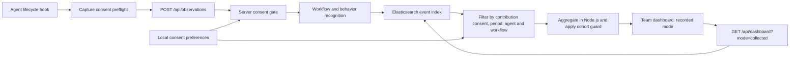

# Integrations: agents and Elasticsearch

This guide covers one capture → store → read path: agent lifecycle hooks feed the local service, recognition derives metadata, storage persists it, and the dashboard reads aggregate statistics. The implemented handler, replay transport and ES adapter are reference code; native packaging and live-client/ES validation remain pending.

Read [Product and experience](product.md) for recording choices and [Architecture](architecture.md) for contracts, recognition, private scoring and enforcement.

- [Agent capture and consent](#agent-capture-and-consent)
- [Collector and replay](#collector-and-replay)
- [Agent-specific integration](#agent-specific-integration)
- [Elasticsearch and the team dashboard](#elasticsearch-and-the-team-dashboard)
- [Deployment limits](#deployment-limits)

## Runtime configuration

Run commands from the repository root. [.env.example](../.env.example) documents settings but is not loaded automatically: export variables before starting or use `node --env-file=.env server.mjs`. Restart for environment changes; UI preferences and rule overrides persist without restarting.

| Variable | Purpose / default |
| --- | --- |
| `HOST`, `PORT` | Local service: `127.0.0.1:4310` |
| `DATA_DIR` | Local runtime files: `./data` |
| `RULES_FILE` | Recognition/point overrides: `DATA_DIR/rules.json` |
| `PRIVACY_FILE` | Consent preferences: `DATA_DIR/privacy.json` |
| `PM_SIGNAL_MEMBER_ID` | Paired service/capture identity: `pm-01` in the runtime default |
| `PERSONAL_TOKEN` | Optional personal capability; generated if unset |
| `PM_SIGNAL_ENDPOINT` | Native capture destination, normally `http://127.0.0.1:4310/api/observations` |
| `PM_SIGNAL_CAPTURE_CONTENT` | Independent permitted-excerpt opt-in, default off; also available as `--include-content` |
| `PM_SIGNAL_TELEMETRY` | `off`, `0` or `false` stops capture before stdin and any network request |
| `INGEST_TOKEN` | Optional collector/rule-write credential; required for non-loopback server binding |
| `COLLECTOR_ENDPOINT` | Replay destination override; CLI also accepts `--endpoint` |
| `CHROME_BIN` | Browser verification executable override |

The example environment uses `local-pm` as its example identity; whichever value you choose, keep the service, capture handler and replay member aligned. ES-specific variables are documented in the [Elasticsearch section](#elasticsearch-and-the-team-dashboard).

## Agent capture and consent

Behavior recognition does not require modifying an agent's model or adding a system prompt that asks it to report every action. The plugin attaches to the **agent runtime** through lifecycle hooks. Those hooks execute a handler outside the model at documented points in the workflow.

```mermaid
flowchart LR
    A[Existing agent client] --> H[Platform lifecycle hooks]
    H --> C[Local capture handler]
    C --> Q[Short delivery retries]
    Q --> O[Observation ingestion]
    O --> R[Configurable keyword recognition]
    R --> E[Normalized PM events]
    E --> S[File / Elasticsearch storage]
    S --> G[Server aggregation]
    G --> D[Statistical dashboard]
```



The implemented path is local capture and server-side keyword recognition. Content transfer is disabled unless explicitly enabled. Original observation text is processed transiently and not stored. Local-only classification and a persistent offline queue are future options.

### Configure the implemented handler

Use [`examples/hooks/claude.json`](../examples/hooks/claude.json), [`examples/hooks/codex.json`](../examples/hooks/codex.json) or [`examples/hooks/copilot.json`](../examples/hooks/copilot.json). Replace the repository path and pair `PM_SIGNAL_MEMBER_ID` with the personal service identity. Recording stays off until the owner opts in under Privacy & telemetry. The templates' include-content flag is an independent excerpt-transfer option; removing it retains metadata-only mode.

The handler checks consent before reading stdin or sending content; missing or unavailable consent stops capture. PM_SIGNAL_TELEMETRY=off skips even the status request. The API rechecks consent before classification/storage, covering races with disable. Supported events remain prompt submission, tool completion and stop; transcript scanning and automatic installation are absent. Short retries can add latency; a durable consent-aware queue is future work.

The handler is covered by representative payload/API tests, not verified in a live installation of every agent. The package layouts below illustrate future packaging; their script paths must be replaced with the actual shared handler path for manual setup.

Hooks provide reliable triggers. A skill or an MCP tool can supply explicit workflow declarations or approved artifact references, but observing calls to our MCP server alone would miss unrelated work. Skills are optional workflow aids, not a complete activity subscription mechanism.

## Collector and replay

[`collector/collect.mjs`](../collector/collect.mjs) is a development and import tool. It reads **already normalized and labeled** JSONL records, fills missing transport defaults, validates the allowed fields, sends batches to `POST /api/events`, and retries short delivery failures.

It does not subscribe to agent activity or parse native hook payloads. Its default mode replays labeled events. With `--observations`, it sends unlabeled task/result text to the server, where the configured rules recognize workflows and behaviors. `collector/capture.mjs` is the native-payload entry point.

Native hook JSON cannot be piped directly into the replay CLI; use `capture.mjs` to translate provider-specific fields and lifecycle names first.

In the product experience, users install a platform adapter once and configure their workspace. Hooks trigger capture automatically. The capture handler normalizes and delivers each hook payload with short retries. The CLI remains useful for replay, debugging and historical imports; product managers do not need to run it during ordinary work. They then open the local workspace directly, without a second Connect an agent step. Installation does not enable telemetry or team contribution; those remain separate, default-off choices in Privacy & telemetry. The current standalone prototype does not yet implement a native plugin installer.

## Agent-specific integration

Official sources were checked on **2026-11-25**. Features differ by installed version, selected harness and organization policy. Source-code presence is not a promise that every released client exposes a feature.

| Agent surface | Proposed integration | Observation points | Coverage limits |
| --- | --- | --- | --- |
| Claude Code | Native plugin containing command hooks | `SessionStart`, `UserPromptSubmit`, `PreToolUse`, `PostToolUse`, `Stop`, `SessionEnd` | Claude Code surfaces that load the plugin; does not imply Claude.ai web-chat coverage |
| Codex | Native hooks in a supported client/configuration; packaged adapter after version validation | `SessionStart`, `UserPromptSubmit`, `PreToolUse`, `PostToolUse`, `Stop`, `SessionEnd` in current official hook implementation | Verify installed release, hook trust and client support; do not assume access to all desktop/cloud conversations |
| GitHub Copilot CLI | Hook configuration invoking the capture handler | `sessionStart`, `userPromptSubmitted`, `preToolUse`, `postToolUse`, `agentStop`; `sessionEnd` is CLI-specific in the checked reference | Local CLI sessions; cloud execution is a separate deployment |
| Copilot in VS Code | Runtime hooks for the selected Copilot harness | Supported hooks and input format documented by that harness | Hooks are preview in the checked VS Code guide; changing the model does not change the harness |
| SDK-owned Codex sessions | Codex SDK event stream | `runStreamed()` emits structured events including `item.completed` and `turn.completed` | Only sessions our integration starts or explicitly resumes; not global observation of the existing app |

The current Codex source includes native hooks; the older `notify` command is a **legacy turn-completion callback**, not the preferred full capture mechanism. It receives a JSON argument rather than the normal native-hook stdin payload. A version without full hooks must report reduced capture coverage instead of presenting turn-completion notifications as a complete workflow trace.

### Claude Code packaging

Proposed plugin files:

```text
pm-signal-plugin/
  .claude-plugin/plugin.json
  hooks/hooks.json
  scripts/capture.mjs
  runtime/                  # proposed delivery/configuration package
```

Claude Code discovers a plugin manifest under `.claude-plugin/`; hook files and scripts live outside that directory. A future plugin can be tested with `claude --plugin-dir /path/to/pm-signal-plugin` and later distributed through a plugin marketplace.

Use the [repository hook template](../examples/hooks/claude.json) with the installed client’s supported configuration format; replace the absolute handler path before loading it.

The handler reads JSON from stdin. Claude fields include `session_id`, `hook_event_name`, and event-specific `prompt`, `tool_name`, `tool_input`, `tool_response` and `tool_use_id`. Newer versions expose additional correlation fields; those are optional in an adapter.

`transcript_path` is a reference to local conversation data, not permission to upload it. The file may also lag the live turn. Use documented event payloads and approved excerpts; do not tail all user histories by default. `UserPromptSubmit` can include scheduled or agent-generated inputs, so the adapter must not count every invocation as a human action without checking origin.

The implemented handler returns empty stdout and does not modify prompts or tool decisions. It has short delivery retries, not a durable queue. Future packaging should minimize hook latency and preserve pending-event consent on delivery.

### Codex native hooks

The checked official source loads `hooks.json` from effective configuration folders and supports hooks in configuration layers and plugins. For a first integration, validate a project-level `.codex/hooks.json` against the installed client's documentation and normal hook-trust controls.

Use the [repository hook template](../examples/hooks/codex.json) with the installed client’s supported configuration format; replace the absolute handler path before loading it.

The current native input schema uses `session_id`, `turn_id`, `hook_event_name`, `cwd`, `prompt`, and tool-event fields such as `tool_name`, `tool_input`, `tool_response` and `tool_use_id`. `transcript_path` may be null. Subagent fields are optional. Similar-looking Claude and Codex payloads still need separate, versioned adapters.

The installer must check the actual Codex release and report supported events before enabling capture. Use the client's normal hook-review flow; do not bypass trust. User-level installation and native plugin packaging should be selected only after validating discovery and distribution in the intended client.

If we build a separate PM workbench, the TypeScript SDK can start/resume a thread and consume `runStreamed()` events. This yields a controlled session integration, but requires the user to work through that workbench. SDK ownership is not an attach-to-every-existing-session feature.

### Copilot CLI and VS Code

For CLI development, repository hooks are discovered under `.github/hooks/*.json`. The checked reference also documents user-level hook folders and hooks contributed by installed plugins. A packaged product can later use those supported installation scopes rather than adding files to every repository.

Use the [repository hook template](../examples/hooks/copilot.json) with the installed client’s supported configuration format; replace the absolute handler path before loading it.

Camel-case events use fields such as `sessionId`, `timestamp` in epoch milliseconds, `prompt`, `toolName` and `toolArgs`. Compatible PascalCase event names can select a different, snake-case input shape with ISO timestamps. Do not reuse a parser based on event-name capitalization alone without testing the selected schema.

VS Code's checked guide describes a shared Copilot runtime/hook format, but also identifies other harnesses with separate implementations. Select the intended session target, validate its hook loading and payloads, and test a fresh session. A general-purpose VS Code extension cannot be assumed to subscribe to every Copilot prompt through public editor APIs.

Cloud Copilot runs in an ephemeral environment with different hook coverage and network constraints. A local queue or user plugin is not automatically present there; cloud capture needs separate deployment and a reachable approved ingestion endpoint.

Hooks expose technical observations rather than PM categories: a search is not proof of verification, a file write is not proof of adoption, and a stop hook is not acceptance. Permitted excerpts and explicit context/artifact declarations feed server-side rules; insufficient or tied evidence stays unclassified. See [Architecture](architecture.md#recognition-rules) for provenance and recognition, and [Observation contract](architecture.md#observation-contract) for allowed fields.

## Elasticsearch and the team dashboard

The dashboard reads statistics from the PM Signal server. It does not connect to Elasticsearch from the browser. The server uses the configured storage adapter to write derived event metadata to ES, read it back and compute the dashboard aggregates.



The browser receives category counts, behavior rates, trends and other aggregate fields. It receives no stored event records, work-session content or individual scores. ES credentials stay in the server environment. Local workflow templates, briefs, step results and saved run snapshots are not stored in ES.

### Configure the server

Use an existing Elasticsearch instance accessible to the Node.js process. From the repository directory, set:

```sh
export STORAGE_DRIVER=elasticsearch
export ES_URL=http://localhost:9200
export ES_INDEX=aipm-events
export PM_SIGNAL_MEMBER_ID=pm-01
# If ES requires authentication, set its encoded API key:
# export ES_API_KEY=...
# Optional collector/rule-write credential, separate from the ES key:
# export INGEST_TOKEN=...
npm run dev
```

Restart an already running server after changing these values. `.env.example` documents the options; it is not loaded automatically. Alternatively, create a local `.env` and run `node --env-file=.env server.mjs`. Changing drivers does not migrate existing JSONL events into ES.

| Setting | Used by |
| --- | --- |
| `STORAGE_DRIVER=elasticsearch` | Server selects `ElasticsearchStorage` |
| `ES_URL` | ES cluster endpoint; HTTP or HTTPS, without embedded credentials |
| `ES_INDEX` | Event index; defaults to `aipm-events` |
| `ES_API_KEY` | Server sends `Authorization: ApiKey ...` to ES |
| `INGEST_TOKEN` | Capture/replay clients authenticate writes to PM Signal; it is not an ES credential |
| `PRIVACY_FILE` | Local consent preferences, including team contribution |
| `TEAM_MIN_PARTICIPANTS` | Minimum opted-in collected cohort; defaults to 3 |

The adapter creates the index with strict mappings when first used. The ES credential needs permissions for the operations described below, including index creation/mapping updates, read, write and exact-owner deletion. Connection status from `/api/config` checks the cluster endpoint; it does not prove all index operations are permitted.

### Send data and display recorded statistics

1. Open `http://127.0.0.1:4310/` to access the configured personal workspace.
2. In **Privacy & telemetry**, enable private telemetry if you want to record. Enable **Contribute to team usage statistics** separately if you want that metadata included in team aggregates.
3. Configure the agent hook as described in [the agent setup above](#agent-capture-and-consent), or replay the bundled observations to demonstrate ingestion:

   ```sh
   npm run collect -- --observations --source codex --member pm-01 --file examples/observations.jsonl
   ```

4. Open `http://127.0.0.1:4310/team` and change **Demo insights** to **Shared aggregates**. The UI uses `mode=collected` to read ES-backed events. The label refers to voluntarily contributed usage statistics, not a method-sharing feature.
5. Choose the period, agent and workflow filters. The server applies those filters and the cohort guard before returning the chart/table data.

The replay CLI uses `INGEST_TOKEN` from its environment if configured. In a separate terminal, use the same credential as the server. The example member ID must match the configured workspace identity and its consent preferences. Paused ingestion reports zero stored events. Stable example IDs make replay idempotent; repeating a sample does not create fresh activity.

**Demo insights** always uses synthetic events and does not demonstrate ES reads. The default three-contributor guard also means this single-identity prototype cannot display a populated collected team dashboard from one PM. For an isolated single-PM plumbing demonstration, restart with `TEAM_MIN_PARTICIPANTS=1`; this intentionally changes the default privacy guard. Multi-user enrollment and a shared team consent service are not implemented. The standard demo view illustrates a team without needing that setup.

### What the adapter does

| Operation | ES request | Prototype behavior |
| --- | --- | --- |
| Index setup | `PUT /<index>` and, for an existing index, `PUT /<index>/_mapping` | Strict event mapping; additive recognition fields for an existing index |
| Event write | `POST /_bulk?refresh=wait_for` | NDJSON `create`, event ID as document ID; conflicts count as duplicates |
| Event read | `POST /<index>/_search?scroll=1m` and `POST /_search/scroll` | Reads pages of 1,000 records; clears the cursor afterwards |
| Owned deletion | `POST /<index>/_delete_by_query?refresh=true` | Exact `memberId` term; checks for incomplete deletion |
| Connection status | `GET /` | Cluster reachability, without returning credentials to the UI |

Event fields include `id`, `sessionId`, `memberId`, `source`, `timestamp`, `task`, `action`, `origin`, `taskMethod`, `actionMethod`, `observationId` and `recognitionVersion`. IDs/categories use keyword mappings and timestamps use a date mapping. For native observation recognition, original permitted text is processed transiently and derived events use generic titles/evidence. The index is not a transcript store.

Consent filtering, period/workflow/platform filtering, activity grouping, chart generation and the cohort check currently run in `server.mjs` / `lib/analytics.mjs` after the adapter reads the event index. This implementation is easy to inspect for a reference prototype. Large deployments would need server-side ES queries/aggregations and pagination rather than reading the whole index for every dashboard request.

Consent and rule overrides remain local JSON even when events use ES. Sharing an ES index between multiple independent local processes does not create a coherent team consent system. Production team access would require authenticated identities and a shared transactional consent store. See [Architecture](architecture.md#consent-and-identity) for that boundary.

### Quick diagnosis and verification

| Observation | Check |
| --- | --- |
| Charts still show the synthetic preview | Select **Shared aggregates**, not **Demo insights** |
| ES contains events but team counts are withheld | Contribution consent, current filters and the minimum cohort |
| Replay reports paused records | Private telemetry must be enabled for the recorded member |
| Replay reports duplicates | Stable IDs already exist; use new observations for new activity |
| Storage status fails or the workspace is unavailable | ES URL/authentication, index permissions, compatible mappings and server logs |
| JSONL history is missing after changing drivers | No automatic migration; replay source records through consent-gated ingestion |

Storage tests cover mapping, Bulk writes, duplicate conflicts, partial failures, Scroll and exact-member deletion with simulated ES responses. A live ES cluster has not been verified in this prototype. Run `npm test` for those checks and `npm run verify:browser` for dashboard and privacy behavior.

## Deployment limits

The service implements one local personal identity, a serialized consent gate, a default three-contributor guard and aggregate-only team reads. It does not implement hosted organization roles or a shared multi-instance consent store. See [Architecture](architecture.md#consent-and-identity).

The native handler normalizes prompt/tool/stop payloads and checks consent before content processing. It does not install hooks, read transcripts, perform local recognition or keep a durable offline queue. Short retries preserve IDs within an invocation. A pilot adapter should verify installed versions, event coverage, normal client hook trust, latency, duplicate capture prevention and missing-event behavior.

SDK-owned sessions cover only work the integration starts or resumes; cloud runtimes require their own approved deployment and endpoint. Repeated tasks need distinct occurrence IDs, while retries must retain those IDs. Replaying observations across changed recognition policies is not historical reclassification.

No plugin has been installed into the user’s actual agents by this prototype. Provider mechanisms below reflect the previous source review on 2026-11-25, not a new cross-version validation.

## Official references

- [Claude Code hooks](https://code.claude.com/docs/en/hooks): lifecycle, stdin payloads, command configuration and output behavior.
- [Claude Code plugin manifest](https://code.claude.com/docs/en/plugins/manifest-reference): package layout and hook components.
- [Codex hooks guide](https://developers.openai.com/codex/hooks/): official user-facing documentation. The website returned HTTP 403 in this environment; the following official repository sources were inspected instead.
- [Codex hook discovery](https://github.com/openai/codex/blob/main/codex-rs/hooks/src/engine/discovery.rs) and [hook configuration](https://github.com/openai/codex/blob/main/codex-rs/config/src/hook_config.rs): configuration loading and trust.
- [Codex hook input schemas](https://github.com/openai/codex/tree/main/codex-rs/hooks/schema/generated): provider event payloads.
- [Codex legacy notify](https://github.com/openai/codex/blob/main/codex-rs/hooks/src/legacy_notify.rs): reduced legacy turn-completion mechanism.
- [Codex TypeScript SDK](https://github.com/openai/codex/blob/main/sdk/typescript/README.md): owned session integration and event streaming.
- [Copilot hook configuration](https://docs.github.com/en/copilot/reference/hooks-configuration): scopes, events, payloads and cloud limitations.
- [VS Code agent hooks](https://code.visualstudio.com/docs/copilot/customization/hooks): preview status and selected-harness integration.

Repository links follow the default branch. Pin provider versions and schema fixtures when implementing an adapter; this design is not a cross-version compatibility guarantee.
